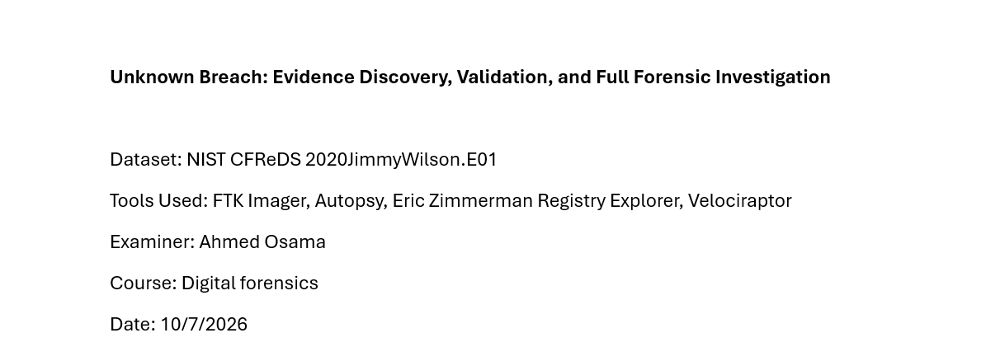
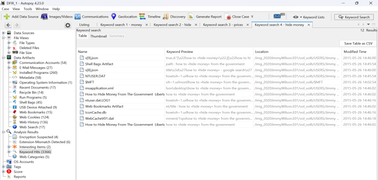
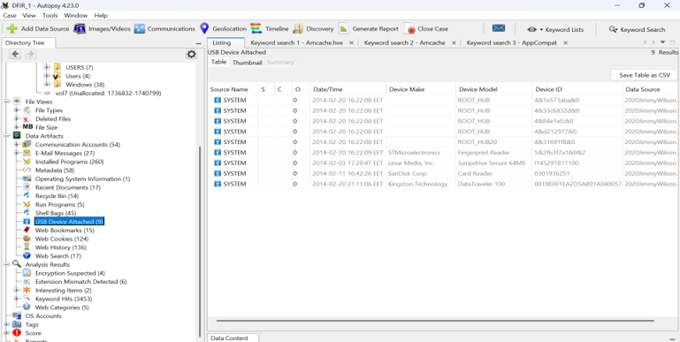
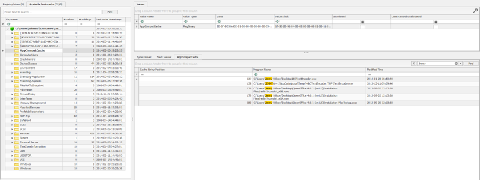
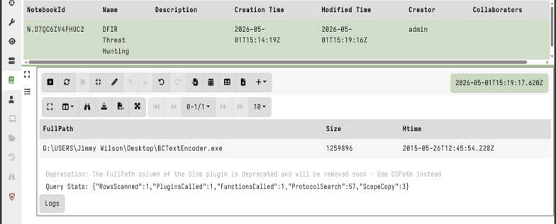

# Unknown Breach: Evidence Discovery, Validation, and Full Forensic Investigation

A Windows Digital Forensics and Incident Response (DFIR) investigation using the public **NIST CFReDS 2020JimmyWilson.E01** forensic image.

The project follows a structured forensic workflow from evidence validation and initial triage through Windows artifact analysis, threat-hunting simulation, timeline reconstruction, and final reporting.

## Project Objective

The goal was to investigate suspicious user activity in a Windows forensic image, identify and correlate relevant artifacts, reconstruct the sequence of events, and build an evidence-based case narrative.

## Dataset

- **Source:** NIST CFReDS
- **Image:** `2020JimmyWilson.E01`
- **Format:** E01
- **MD5:** `b267fb0cd94645425eee00258d3a9b58`
- **SHA1:** `a1102c70a50768b588225fdcad6efa5d5d57341b`
- **Validation:** MD5 and SHA1 matched during FTK Imager verification

> The raw forensic image is intentionally **not included** in this repository.

## Tools Used

| Tool | Purpose |
|---|---|
| **FTK Imager** | Evidence validation, image inspection, and read-only mounting |
| **Autopsy 4.23.0** | Disk analysis, deleted files, browser artifacts, USB artifacts, LNK/recent documents, and keyword searches |
| **Eric Zimmerman Registry Explorer** | Run/RunOnce, UserAssist, and ShimCache/AppCompatCache analysis |
| **Velociraptor 0.76.4** | Threat-hunting simulation against the mounted forensic image using VQL |

## Investigation Workflow

1. Selected the public NIST CFReDS Windows forensic dataset.
2. Verified evidence integrity using MD5 and SHA1 hashes in FTK Imager.
3. Performed initial triage to identify the operating system, users, suspicious files, and areas for deeper investigation.
4. Used Autopsy to review recent documents, LNK artifacts, deleted files, browser activity, USB artifacts, and keyword hits.
5. Analyzed Windows registry artifacts with Registry Explorer, including Run/RunOnce, UserAssist, and ShimCache/AppCompatCache.
6. Reviewed Prefetch and attempted Amcache analysis.
7. Mounted the E01 image as `G:\` and used Velociraptor to search for known indicators and persistence locations.
8. Correlated artifacts to reconstruct the incident and create a timeline.
9. Documented findings, limitations, recommendations, and the final assessment.

## Key Findings

- Suspicious activity was concentrated under the **Jimmy Wilson** user profile.
- Pricing-related artifacts included `New Price List.txt`, `New Price List Encoded.txt`, and related LNK/recent-document entries.
- Browser and keyword artifacts referenced **“How to Hide Money From the Government.”**
- `BCTextEncoder.exe` was identified in Jimmy Wilson's Desktop path through **ShimCache/AppCompatCache** analysis.
- Velociraptor independently located `BCTextEncoder.exe` at:

```text
G:\USERS\Jimmy Wilson\Desktop\BCTextEncoder.exe
```

- USB artifacts showed Lexar, SanDisk, and Kingston removable-device activity.
- Run/RunOnce and Startup-folder checks did not identify a suspicious persistence mechanism.
- The available evidence most strongly supported **suspicious user-driven concealment or obfuscation of pricing-related information**.

## Evidence Highlights

### 1. Case Overview


### 2. Keyword Search and Evidence Discovery


### 3. USB Artifact Analysis


### 4. ShimCache Artifact Analysis


### 5. Threat Hunting with Velociraptor


## Repository Structure

```text
Unknown-Breach-DFIR-GitHub/
├── README.md
├── DISCLAIMER.md
├── .gitignore
├── analysis/
│   ├── artifact_summary.md
│   ├── dataset_and_hashes.md
│   └── timeline.md
├── docs/
│   ├── Digital_Forensics_Investigation_Report.pdf
│   └── Digital_Forensics_Project_Presentation.pptx
├── queries/
│   └── velociraptor_queries.vql
└── screenshots/
    ├── 01_case_overview.png
    ├── 02_autopsy_keyword_search.png
    ├── 03_autopsy_usb_artifacts.png
    ├── 04_shimcache_registry_explorer.png
    └── 05_velociraptor_threat_hunt.png
```

## Documentation

- [Full Forensic Report](docs/Digital_Forensics_Investigation_Report.pdf)
- [Project Presentation](docs/Digital_Forensics_Project_Presentation.pptx)
- [Dataset and Hashes](analysis/dataset_and_hashes.md)
- [Artifact Summary](analysis/artifact_summary.md)
- [Investigation Timeline](analysis/timeline.md)
- [Velociraptor VQL Queries](queries/velociraptor_queries.vql)

## Skills Demonstrated

- Windows digital forensics
- Evidence integrity validation
- Disk-image analysis
- Windows registry forensics
- Deleted-file and Recycle Bin analysis
- Browser and keyword artifact analysis
- USB artifact analysis
- Prefetch and ShimCache analysis
- Threat-hunting with Velociraptor and VQL
- Timeline reconstruction
- Evidence correlation and forensic reporting

## Important Forensic Notes

This repository distinguishes **confirmed evidence** from investigative hypotheses. A ShimCache entry can support historical file presence or possible execution traces but does not independently prove execution. Likewise, USB device artifacts confirm device connection but do not by themselves prove that a specific file was transferred.

## Author

**Ahmed Osama**  
Computer Science / Cybersecurity Student

---

*Educational DFIR project based on a public NIST CFReDS training dataset.*
